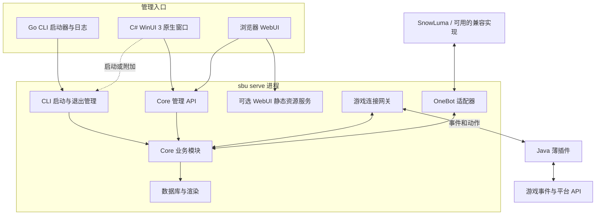

# ShitBotUltra 总体规划

规划日期：2026-11-08。状态：四仓库已建立，语言与架构按本方案逐步实施；尚未交付运行程序、兼容性或性能结果。

依据：当前 ShitBot 源码、文档及维护者本次需求。源码基线、外部资料及适用边界见[参考项目与依据](05-参考项目与依据.md)。

## 1. 产品目标与边界

将 ShitBot 从“Minecraft 插件内运行全部事务”演进为“独立主程序运行全部业务，游戏插件提供接入能力”。保留普通版已有功能作为迁移目标，同时让服务器管理员可以选择命令行、Windows 桌面或浏览器管理。

已确定的需求：

- ShitBot 继续位于个人仓库；Ultra 系列放在 `ShitBot-Team` 组织。
- Core、CLI、Desktop、Minecraft 插件分仓库；其他组件先保持模块形式。
- Ultra 四仓库采用 AGPL-3.0-only；公共计划和协作规则统一保存在 Core 仓库，其他仓库引用。普通版保留自己的 MIT 许可。
- CLI 参考 LuckyLillia.CLI 的轻量启动器体验：直接运行、少量参数、持续日志；自带 WebUI，最终用户无需为 WebUI 单独安装 Node.js。
- Desktop 优先采用 Windows 原生 UI，推荐 C# + WinUI 3；C# + Avalonia 为跨平台 / 部署条件不合适时的备选。支持直接打开和管理配置文件，也支持开启 WebUI。
- Minecraft 根包固定为 `shitbotteam.ultra.minecraft`，其他需要统一前缀的组件将末段替换为 `core`、`cli`、`desktop` 或 `webui`；实际包 / 模块形式遵循所用语言规则。
- 所有业务源码、协议和构建过程公开；文档、界面和日志允许以中文为主。提交信息采用 Conventional Commits，英文类型前缀配中文或英文描述，人工与 AI 辅助提交遵循相同规则。
- 支持 bStats；具体统计 ID 和其他服务接口后续补充。
- SnowLuma 为新用户推荐入口；LLBot 为已有可用环境的兼容选项；问题反馈留在本项目渠道。

“JAR 只负责监听”在实现上应定义为 **薄游戏适配器**：监听与上报事件，读取游戏状态，以及执行 Core 下发的游戏动作。广播、踢人、背包采集、PAPI 查询、登录拦截都需要游戏进程内的 API，不能仅靠主程序从外部完成。JAR 不再承担 QQ 规则、账号绑定数据库或图片渲染。

首期采用单 Core 实例管理多服务器的部署模型，不引入微服务集群、消息中间件、商业授权中心或插件商店。原版与 Ultra 独立发布，原版不被自动覆盖。

## 2. 编程语言与技术选型

### 2.1 推荐组合

| 部分 | 推荐 | 选择理由与代价 |
| --- | --- | --- |
| Core | Go | 适合网络连接、并发 I/O 和独立服务交付；语法与工具链便于新贡献者入门。重写现有 Java 业务需要逐项迁移，图片能力是单独难点 |
| CLI | Go + 标准库 `flag` | 与 Core 同语言；模仿 LuckyLillia.CLI 的轻量参数入口，用标准库处理参数、信号与退出，直接启动服务、输出日志和管理地址 |
| Desktop | C# + WinUI 3 + XAML | 优先满足 Windows 原生界面；使用 CommunityToolkit.Mvvm 组织界面状态，异步访问 Core。发行时明确 .NET 与 Windows App SDK 依赖 |
| Minecraft | Java + Maven | 延续现有平台经验与 API 生态；使用多模块隔离平台依赖，按平台发布 JAR |
| WebUI | TypeScript + Vue 3 + Vite | 表单、状态展示、配置编辑的开发路径直接；只管理界面状态，通过 Core API 读写业务 |
| 数据 | SQLite 起步，按迁移需要补 MySQL | 一个 Core 可服务多个 JAR，多服不再天然要求共享 MySQL；大规模或既有 MySQL 环境保留迁移路线 |
| 通信 | Minecraft 使用 WebSocket + JSON；管理使用 HTTP JSON + SSE | 首期便于抓取脱敏消息和排障，兼顾 Java、Go、C#、浏览器；正式契约由 Core 仓库维护 |

Go 的 `embed` 可以在构建时把 WebUI 静态资源嵌入程序；`internal` 的可见性适合保护业务实现。CLI 分仓后必须使用明确导出的运行入口，不能导入另一个仓库的 `internal`。依据见 [Go 模块组织](https://go.dev/doc/modules/layout)与 [embed 文档](https://pkg.go.dev/embed)。

这里推荐 Go，是对“贡献者上手、维护成本、网络服务能力、分发方式”的综合判断，不声称它是所有人使用最多或任何负载下最快的语言。渲染、数据库、队列和外部机器人连接都可能成为瓶颈；性能结论留给维护者之后实际测量。

### 2.2 为什么不默认选另外几条路线

| 路线 | 适合之处 | 本项目取舍 |
| --- | --- | --- |
| Rust 写 Core 和 CLI | 无 GC、约束严格，也能实现轻量启动器 | 可行，但目前保留 Go，方便 CLI 直接托管同语言 Core；参考项目的使用体验不要求沿用其实现语言 |
| Rust + Win32 写桌面 | 可以通过 Windows API 构建本地窗口与控件 | 技术上可行，但需要更多窗口、控件和消息循环接线；当前改选 C# + WinUI 3 的 XAML 和绑定体系 |
| C 写桌面或 Core | 可直接调用系统 API、控制底层资源 | GUI、内存生命周期、网络和并发都需更多手工维护；对当前管理工具收益有限 |
| Java 写 Core + CLI | 可以较多复用现有业务与 Java2D | 是“最快保留功能”的有力备选；若后续发现 Go 图片迁移成本过高，应明确评估这一备选，而不是偷偷保留服务器端重组件 |
| TypeScript / Node.js 写 Core | 前端贡献者容易参与、生态丰富 | 也可行；目前选择 Go 统一核心服务与 CLI 的构建交付 |
| C# + Avalonia 写桌面 | .NET / XAML，可面向多个桌面系统 | 作为 WinUI 部署条件不合适或将来需要跨平台时的备选；使用自绘控件，不等同于 Windows 原生控件 |
| Tauri / Wails 桌面 | 可以复用 Web 前端 | 默认界面仍依赖 WebView，不采用为此次“Desktop 不用 WebUI”的默认解释 |

**桌面默认方案确定为 C# + WinUI 3，优先满足 Windows 原生 UI。** WinUI 3 是 Windows App SDK 的原生桌面 UI 框架，官方支持 C# / C++ 与 XAML；界面直接采用 WinUI 控件，不以 WebView 承载管理页。最低 Windows 版本、.NET 和 Windows App SDK 版本在实施时固定并写入发行矩阵。[WinUI 3 官方介绍](https://learn.microsoft.com/en-us/windows/apps/winui/winui3/)

采用 MVVM 分离 View、ViewModel 和 Core 客户端；CommunityToolkit.Mvvm 不绑定特定 UI 框架，便于以后保留非 UI 代码。若改用 Avalonia，需要迁移 XAML 控件、主题和平台集成，不能承诺只换一个依赖即可完成，也不同时维护两套桌面 UI。[MVVM Toolkit](https://learn.microsoft.com/en-us/dotnet/communitytoolkit/mvvm/)、[Avalonia 官方说明](https://docs.avaloniaui.net/docs/welcome)

C# 桌面负责配置、状态和日志，核心事务继续由 Go 执行。界面更新采用日志批处理、虚拟化和异步 I/O；不预先断言不同框架的内存、启动速度或渲染性能完全相同。性能和中文输入、DPI、键盘操作、无障碍表现留给维护者在实现后自行确认。

## 3. 仓库与组织安排

现有 `ShitBotUltra` 仓库作为 Core，同时承载项目入口与共享文档。

| 归属 / 仓库 | 定位 | 产物 |
| --- | --- | --- |
| `hutuyee/ShitBot` | 普通版，继续独立维护 | 现有平台插件与相关构件 |
| `ShitBot-Team/ShitBotUltra` | Ultra Core、协议、内置 WebUI、架构文档 | Go module、协议及 WebUI 随版本的源码 / 构建资产 |
| `ShitBot-Team/ShitBotUltra-CLI` | 轻量启动器与 Core 进程宿主 | Windows / Linux 的 `sbu` 可执行文件及部署示例 |
| `ShitBot-Team/ShitBotUltra-Desktop` | C# WinUI 3 Windows 原生桌面客户端 | 桌面程序、运行依赖及与之兼容的 `sbu.exe` |
| `ShitBot-Team/ShitBotUltra-Minecraft` | 所有 Minecraft 平台薄适配器 | 按平台区分的 JAR，后续可有 Java SDK |

四个 Ultra 仓库均已建立；当前仅初始化计划、协作文件和许可证。各组件入口见 [Core](../../plan.md)、[CLI](https://github.com/ShitBot-Team/ShitBotUltra-CLI/blob/main/plan.md)、[Desktop](https://github.com/ShitBot-Team/ShitBotUltra-Desktop/blob/main/plan.md)、[Minecraft](https://github.com/ShitBot-Team/ShitBotUltra-Minecraft/blob/main/plan.md)。

公共架构、目录规范、协议、迁移、思维导图、贡献规范和 Agent 规则集中存放于本仓库，各组件只保留自己的 `plan.md`、`agent.md` 和引用入口。每仓库分别保留完整 `LICENSE`，方便独立分发；许可边界统一见[许可证说明](../licensing.md)。三个新组件的 README 后续再写。

暂不拆 WebUI、协议、渲染器、公共工具仓库；模块有独立用户、发布周期或维护人后再拆。PictureBridge 继续作为已有独立项目协作，不合并进游戏插件。

每个仓库独立版本，另外维护一张经过维护者确认的兼容表：`CLI版本 → Core版本 → Bridge协议版本 → Desktop支持的管理API版本 → Minecraft版本`。仓库版本号不必完全相同。桌面发行包固定 CLI 版本及校验值，CLI 的 `go.mod` 固定 Core 版本；禁止依赖浮动 `main` 或启动时拉取“最新核心”。

## 4. 进程与依赖架构

### 4.1 一份 Core，多种入口

Core 首期是可嵌入的 Go 业务库。直接运行 `sbu` 即进入常驻模式，`sbu serve` 是同一启动入口的显式写法；二者都在当前进程托管同一份 Core。终端显示启动状态、连接日志和管理地址，日常管理通过 WebUI。后续确有需要的管理子命令才通过 API 访问实例。

Desktop 不跨语言链接 Go，也不重写 Go 业务。它包含固定版本的 `sbu.exe`，以无控制台窗口的子进程启动 `sbu serve --no-webui`，然后通过受保护的本机 API 操作 Core。已经有 CLI / 系统服务运行时，Desktop 直接连接该实例，并保留其 WebUI 设置。



编译依赖只有 `CLI → Core`；Desktop 与 Minecraft 依赖的是版本化协议。Desktop 打包依赖 CLI 的发行资产，但 Core 不反向依赖任何桌面代码。C# 与 Go 通过管理 API 协作，首期不做 Go 动态库或跨语言 FFI。

### 4.2 Core 内部职责

- **连接层**：OneBot、Minecraft 会话、管理 HTTP / SSE；只做编解码、认证和协议边界。
- **业务模块**：绑定、白名单、消息路由、群命令、玩家资料、图片任务、配置生命周期。
- **基础设施**：SQLite / MySQL、资源存储、图片执行器、日志、更新包校验。
- **宿主入口**：接收配置，组装依赖，启动、健康状态、优雅停止；不暴露数据库实现。

按业务模块组织，接口放在使用它的模块附近。队列、任务超时、取消和日志上下文统一；首期用进程内调用与有界队列，不把每个功能拆成远程服务，也不为每个类机械创建接口。

### 4.3 Core 与 JAR 的具体边界

| 事务 | Core | JAR |
| --- | --- | --- |
| QQ 消息、群权限、转发规则 | 连接、过滤、授权、去重、路由 | 上报游戏聊天、执行游戏广播 |
| 绑定 / 白名单 | 验证码、账号关系、登录决策、存储 | 获取可信玩家身份、在登录事件中应用结果、踢人 |
| TPS / 在线 / 背包 | 汇总、缓存、查询权限、持久化、渲染 | 读取真实平台状态并发送结构化快照 |
| PAPI / 第三方游戏插件 | 编排查询、模板绑定、超时 | 在正确调度器和插件 API 上读取数据 |
| 命令 | 群身份授权、参数约束、目标服务器选择、审计 | 受限动作执行、必要的本地权限核查、返回结果 |
| 图片与媒体 | 下载策略、缓存、模板、编辑器、渲染、资源分发 | 发送文本 / 组件 / PictureBridge 消息 |
| 更新 | 发现、兼容信息、签名校验、维护操作 | 自身版本信息；替换 JAR 由维护流程完成 |

登录线程不能无限等待 Core；Folia 必须使用对应实体 / 区域调度器。断线、旧授权缓存及重复命令的规则写入[通信方案](03-协议配置与迁移.md)，不能用“薄插件”省略这些基础约束。

## 5. CLI、Desktop 与 WebUI 使用形态

### 5.1 CLI 按轻量启动器设计

[LuckyLillia.CLI](https://github.com/LLOneBot/LuckyLillia.CLI) 使用 Rust，在入口直接读取 `std::env::args()`，自行识别少量参数；相关模块负责子进程、输出和退出。其当前依赖清单与入口没有采用大型命令行框架。Ultra 模仿这种轻量入口与生命周期分工，采用 **Go 标准库 `flag` + `os/signal` + `context`**，不引入 Cobra，也不再保留其候选位置。[参考项目依赖](https://github.com/LLOneBot/LuckyLillia.CLI/blob/main/Cargo.toml)、[参考项目入口](https://github.com/LLOneBot/LuckyLillia.CLI/blob/main/src/main.rs)、[Go flag](https://pkg.go.dev/flag)

用户下载后直接运行程序，就能看到运行情况，再打开浏览器管理。保留 Go 是为了继续在同一进程调用已有规划中的 Go Core；参考项目的 Rust 语言和多子进程拓扑不成为强制要求。QQ 连接仍通过独立的 SnowLuma 等 OneBot 实现配置。

以下命令仅为拟定交互，不是已经存在的程序：

```text
sbu
sbu --config-dir <目录>
sbu --webui
sbu --no-webui
sbu --debug
sbu --help
sbu --version
sbu serve --config-dir <目录> --no-webui
```

- Windows 可双击 `sbu.exe`，Linux 可执行 `./sbu`。首次运行在确定的配置目录生成默认文件和本机管理凭据，启动 Core 及本机 WebUI；机器人 / 游戏连接缺少有效配置时显示“待配置”，由用户完成设置后再连接。
- 未指定开关时使用配置文件的 WebUI 设置，新配置默认开启；`--webui` / `--no-webui` 显式覆盖本次运行，二者同时出现时报参数冲突。直接启动不强制弹浏览器，输出本机访问地址及受限的首次登录引导；长期 Token 不打印到 URL 或普通日志。
- 日志持续显示启动、连接和错误状态；`--debug` 提高诊断细节但仍脱敏。Ctrl+C 请求 Core 优雅停止、取消任务和关闭连接；不停止由用户独立运行的 Minecraft 或机器人实现。
- CLI 面向 Windows / Linux，输出流便于 systemd、Windows 服务包装器或容器接管。无终端环境不得依赖交互式输入；开机自启安装是用户明确执行的操作。
- CLI 与 WebUI 随发行资产提供，首次启动不依赖自动下载未固定版本的核心组件。以后增加 `--update` 时再使用已有签名与兼容方案。
- `--help` / `--version` 在启动 Core 前处理，不创建配置、不连接网络。参数名称精确识别，未知参数、缺少值或互斥开关给出明确中文错误；维护命令只做有限入口分发，不另建复杂命令框架。
- `config validate` 保留给只读配置校验和桌面集成；`migrate` 等维护命令随迁移功能提供。`status`、`server list`、`binding list` 等不是首期必需，主要管理入口为 WebUI / Desktop。

### 5.2 WebUI 与 Windows Desktop

- WebUI 的静态文件随 Core 编译进 CLI；Node.js 仅作为构建工具。WebUI 用于连接状态、配置表单、脱敏事件查看、命令诊断和模板管理。
- Desktop 默认不启用 WebUI 静态页面，但保留本机管理 API；用户点击“开启 WebUI”后可打开浏览器。不能把 WebUI 开关做成关闭整个 API。
- Desktop 提供配置目录选择、原文编辑、表单编辑、备份恢复、日志查看、服务启动 / 停止、连接状态。共享业务校验由 Core 执行。
- Desktop 使用 WinUI 3 控件、XAML 和 C#，界面无需打开浏览器。安装包如何携带 .NET / Windows App SDK 与 CLI 资产单独规划，不预先承诺一个 EXE 且零运行依赖。[Windows App SDK 部署说明](https://learn.microsoft.com/en-us/windows/apps/package-and-deploy/deploy-overview)
- 同一配置目录只允许一个 Core 拥有实例锁，防止 Desktop 和 CLI 重复连机器人、重复发消息或同时改库。
- Desktop 记录进程归属：自行启动的实例可在明确退出操作时停止；附加的系统服务或独立 CLI 不随窗口关闭被杀死。窗口关闭、托盘和后台运行需要清晰提示。

Core 不可用时，游戏本身继续运行；绑定门禁按配置的离线策略处理，互通功能显示离线。桌面或浏览器关闭不应中断独立部署的 Core。

## 6. 分阶段实施

不在这次规划中执行测试、构建或功能实现。下表“完成条件”供维护者之后自行验收，不代表已检查通过。

| 阶段 | 交付范围 | 由维护者确认的完成条件 |
| --- | --- | --- |
| P0：边界与契约 | 四仓库与 AGPL-3.0-only 已确定；继续细化协议草案、Java 平台首发矩阵及版本策略 | 名称和接口边界稳定；不编造尚未提供的接口 |
| P1：最小业务闭环 | Go Core + 轻量 CLI，最小 WebUI 连接配置 / 状态页，SQLite，SnowLuma OneBot，Paper 适配器，双向文本、绑定 / 白名单、状态与超时 | 直接启动后能在网页完成基本配置；单服可以绑定和互通；重连不重复执行命令；JAR 不携带数据库与渲染业务 |
| P2：管理体验 | 完整 WebUI、配置事务、脱敏日志；C# WinUI 3 Desktop 启停与配置编辑 | 两种 UI 操作同一 Core；桌面采用 Windows 原生 UI；CLI / Desktop 不重复启动实例 |
| P3：现有功能迁移 | 群快捷命令、TPS、个人信息、基础图片、背包、通知、代理多服及其他平台 | 依据迁移表逐项标注支持 / 部分支持 / 未支持，保留普通版回退路径 |
| P4：完整图片与扩展 | 高级模板、编辑器、PAPI / 数据提供器、PictureBridge、多数据库及迁移工具 | 渲染器和模板明确兼容范围；Java API 的异步远程语义写入迁移说明 |
| P5：发行完善 | 固定版本桌面包、部署文档、更新与回退、bStats、签名资产 | 可从公开源码重建；统计可关闭；发行兼容表完整 |

bStats 有正式 ID 后可以提前进入对应平台阶段；不能为等统计接口阻塞基本运行。只有迁移表中承诺的功能都完成，才称为普通版对应功能的替代方案。

## 7. 后续需确定但不阻塞规划的事项

1. 首发平台：建议 Paper 单服先落地，再迁移 Folia、Velocity / Bungee 和 Nukkit-MOT；完整目标仍覆盖现有平台。
2. 旧 Java 支持范围：以普通版 Java 8 / 17 / 21 的差异为迁移输入，正式版本单独发布矩阵。
3. 桌面发行：按 C# + WinUI 3 落地，确定 Windows / .NET / Windows App SDK 版本与打包方式；只有跨平台需求或部署限制明确不适合时，再采用 Avalonia 备选。
4. 图片实现：先定义中立场景 / 快照格式，再确定 Go 原生渲染或 Core 托管的独立开源渲染进程。不能在没有实现前承诺旧 Java2D 效果完全一致。
5. 更新、统计及服务接口：维护者之后提供 URL、认证方式、请求响应示例和 bStats ID；不预置虚构域名或凭据。

所有待定项均使用明确的默认建议或关闭状态。当前工作交付规划、仓库初始化与共享协作规范，后续以维护者指定的范围开始实现；不把计划中的验收项视为已经完成。
