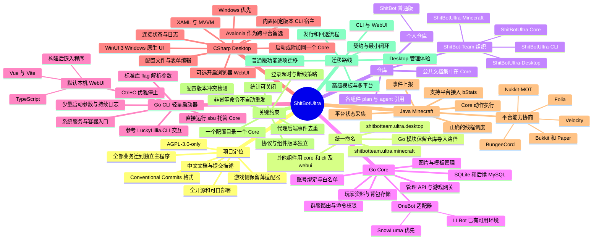

# ShitBotUltra 思维导图

主图对应[总体规划](01-总体规划.md)。支持 Mermaid 的 Markdown 查看器可显示图形；下方保留纯文本版本，避免查看器不支持时无法阅读。



## 纯文本版本

```text
ShitBotUltra
├─ 目标：AGPL-3.0-only、可自部署、主程序统一业务
├─ 命名：shitbotteam.ultra.<组件名>
│  ├─ Minecraft Java 根包：shitbotteam.ultra.minecraft
│  ├─ Desktop C# 根命名空间：shitbotteam.ultra.desktop
│  └─ 其他组件：core / cli / webui，Go 模块保留仓库导入路径
├─ 归属
│  ├─ hutuyee/ShitBot：普通版独立维护
│  └─ ShitBot-Team：Core / CLI / Desktop / Minecraft 四仓库
├─ 文档：公共计划与协作规则在 Core，各组件保留 plan.md / agent.md 引用
├─ Core（Go）
│  ├─ 绑定、白名单、消息路由、群命令、通知
│  ├─ 玩家会话、背包、图片、模板、数据库
│  ├─ OneBot：SnowLuma 优先，LLBot 保留给已有可用环境
│  └─ 游戏网关 + 管理 API + 内置 WebUI 资源
├─ CLI（Go + 标准库 flag）
│  ├─ 直接运行 sbu；sbu serve 是等价显式入口
│  ├─ 少量参数、持续日志、Ctrl+C 优雅停止
│  └─ 默认本机 WebUI，可显式关闭；TypeScript + Vue 3 + Vite
├─ Desktop（C# + WinUI 3 + XAML）
│  ├─ Windows 原生 UI，Avalonia 为跨平台 / 部署条件不合适时的备选
│  ├─ 内置 CLI 宿主，或连接现有 Core
│  ├─ 直接打开配置目录、原文和表单编辑
│  └─ 需要时开启浏览器 WebUI
├─ Minecraft（Java）
│  ├─ 监听上报 + 数据采集 + 游戏动作执行
│  ├─ Bukkit/Paper/Folia、Velocity、Bungee、Nukkit-MOT
│  ├─ 登录决策应用、线程调度和受限连接缓存
│  └─ 支持的平台接 bStats，独立 ID、可关闭
└─ 实施约束
   ├─ 仓库分开，业务实现不重复
   ├─ 单实例锁、配置冲突检查、秘密不进日志
   ├─ 登录有超时，命令结果未知时不盲目重试
   ├─ 老数据只读导入新库，保留回退材料
   └─ Conventional Commits，描述可中文，分批签名提交并确认 Verified
```

总体进程架构图见[总体规划的进程与依赖架构](01-总体规划.md#4-进程与依赖架构)，目录树见[仓库结构](02-仓库结构与开发规范.md)。
